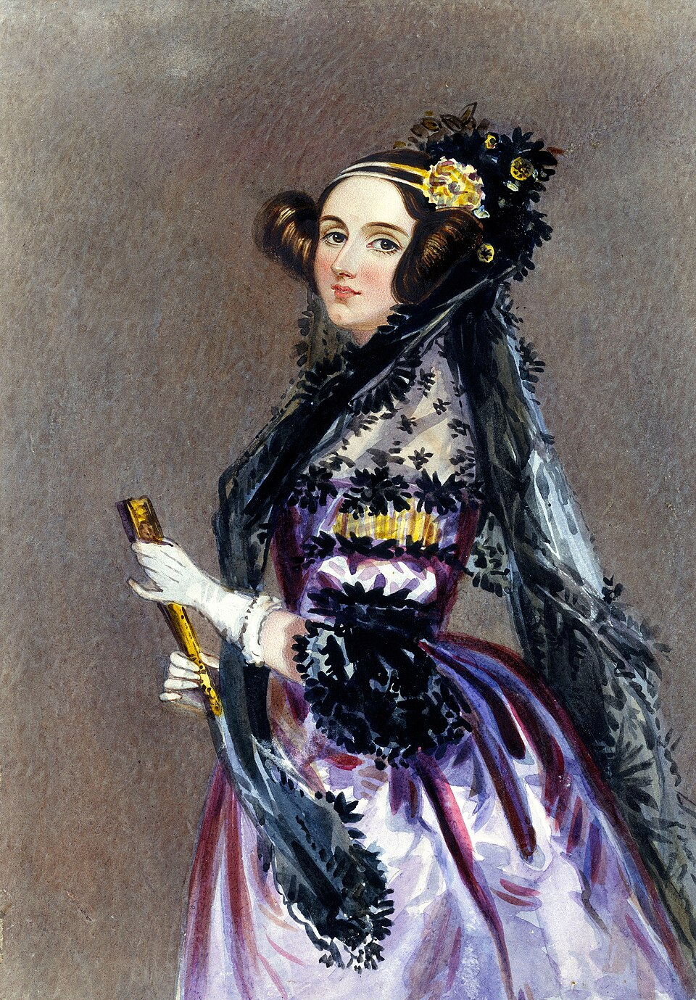
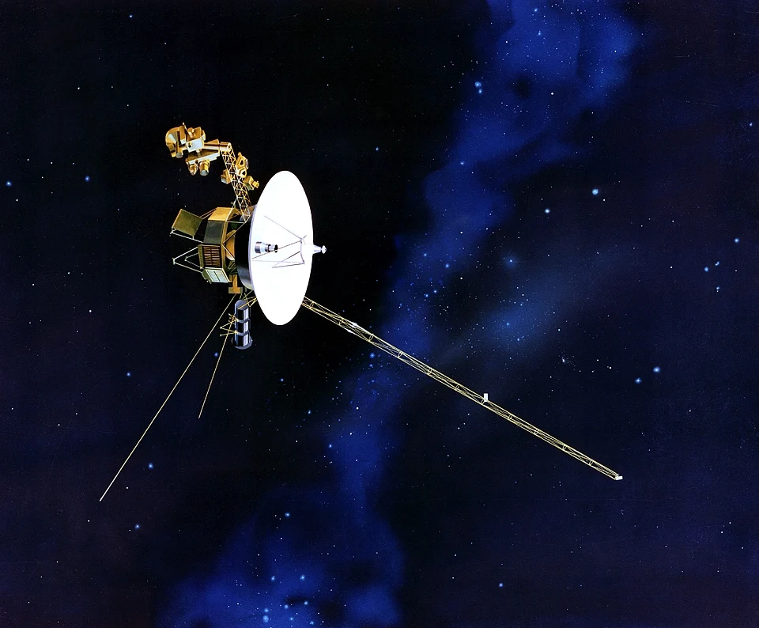

[← Volver al inicio](README.md)

# Temas del curso

### 16/09 · Mis aficiones

Llevo jugando al tenis desde los 9 años. Al principio,
empecé a entrenar solo porque mis amigos iban, pero 
luego me empezó a gustar. Entreno viernes y sábados por 
la mañana y algún día voy con mis amigos a jugar.
También llevo desde pequeña en una academia aprendiendo
inglés, el año pasado me saqué el B2.

Buscando en GitHub he encontrado [English](https://github.com/first20hours/google-10000-english),
una página donde puedes aprender hasta 10000 palabras.

---
### 28/09 · Premios Princesa de Asturias: Leo Messi

Leo Messi es un jugador profesional de fútbol que juega actualmente en el Inter de Miami y en total tiene 47 títulos. Este ha sido galardonado con el Premio Princesa de Asturias de los Deportes de 2026, debido a su gran desarrollo en el deporte, haciendo que esto sea un ejemplo, para las personas, de los beneficios que otorga el deporte. [Su página en la Fundación.](https://www.fpa.es/es/area-de-comunicacion-y-prensa/notas-de-prensa/leo-messi-premio-princesa-de-asturias-de-los-deportes-2026/) Lo he elegido porque me gusta el fútbol y me parece un gran jugador y una gran motivación para todas personas para que hagan deporte ya que otorga grandes beneficios para la salud.

Imagen: Hossein Zohrevand, [Wikimedia Commons](https://commons.wikimedia.org/wiki/File:Lionel-Messi-Argentina-2022-FIFA-World-Cup_(cropped).jpg)

---
### 13/10 · Ada Lovelace

Según la página de [Ada Lovelace en Wikipedia](https://es.wikipedia.org/wiki/Ada_Lovelace), esta fue una matemática y escritora británica muy famosa, es considerada la primera persona programadora de la historia. En 1843, tradujo un artículo del matemático Luigi Menabrea sobre la Máquina Analítica de Charles Babbage y añadió unas notas propias (Notas G) que triplicaron la longitud del texto, en ellas incluyó el paso a paso para calcular los números de Bernoulli, este es considerado como el primer algoritmo diseñado para ser procesado por una máquina. Su día se celebra el segundo martes de Octubre para dar voz a los logros de las mujeres en los campos de ciencia, tecnoogía, ingeniería y matemáticas.

{: width="300"}
*Imagen: Alfred Edward Chalon, [Wikimedia Commons](https://commons.wikimedia.org/wiki/File:Ada_Lovelace_portrait.jpg)*

---
### 27/11 · Voyager 1

Según la página de [Voyager 1 en Wikipedia](https://es.wikipedia.org/wiki/Voyager_1), la Voyager 1 es una sonda espacial de la NASA que fue lanzada el 5 de Septiembre de 1977 para explorar los planetas más alejados del Sistema Solar. Actualmente es noticia porque el 18 de noviembre de 2026 se convirtió en el primer objeto creado por el ser humano en alcanzar una distancia de un día luz de la Tierra. Una curiosidad es que lleva un disco de oro con sonidos, imágenes y saludos de nuestro planeta, por si alguna civilización extraterrestre la encuentra.

| Dato | Voyager 1 |
|---|---|
| Lanzamiento | 5 de septiembre de 1977 |
| Distancia a la Tierra | casi 26.000 millones de km |
| Velocidad | 61.000 km/h |
| Lo que tarda su señal en llegar | 24 horas |
| Años de viaje | 49 años |

{: width="300"}
*Imagen: NASA/JPL, [Wikimedia Commons](https://commons.wikimedia.org/w/index.php?search=voyager+1&title=Special%3AMediaSearch&type=image)*

**Mi Disco de Oro 2026**

- **Lo que pondría:** Pondría el himno de españa.
- **En qué idioma:** No tiene letra por lo que el idioma no es un problema.
- **En qué formato:** En un vinilo con un toca discos, ya que no es muy difícil de usar.

---

